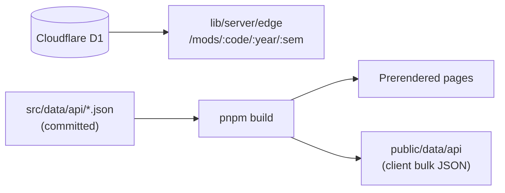

# Data and database

Part of [NTU Mods](../README.md). System overview: [docs/architecture.md](../docs/architecture.md). Site code that reads this data: [src/README.md](../src/README.md).

Course data is produced by [`scraper/`](../scraper/README.md), which also documents publishing (`--load`, `--upsync`), semester codes and data invariants. This page covers how the site consumes that data.



D1 and `src/data/api` are written independently, so a semester is only fully live once both are published.

## Scripts

```bash
pnpm db:seed-local   # Seed the local dev D1 (required for pnpm dev)
pnpm db:build        # Rebuild the local SQLite file from src/data/api
pnpm db:pull         # Download the database from D1 instead (needs wrangler auth)
pnpm db:verify       # Assert the database reproduces every JSON file exactly
pnpm db:dump         # Emit SQL for `wrangler d1 execute --file`
pnpm data            # Regenerate the static artifacts the client fetches
```

`pnpm dev` and `pnpm build` run `pnpm data` first. It reads `src/data/api` directly, so neither it nor prerendering touches D1 or `db/*.sqlite`. That SQLite file exists only for the `db:*` scripts: staging a load before it is applied to D1, and verifying that D1 matches the JSON.

The D1 schema lives in `migrations/`.

## The current semester

The current semester is derived, not configured. It is the newest semester that has offerings, ordered by sort key, taken from `src/data/api` for prerendered pages and the client, and from D1 for the on-demand route. When a new semester arrives, publish it and rebuild; there is nothing to edit.
