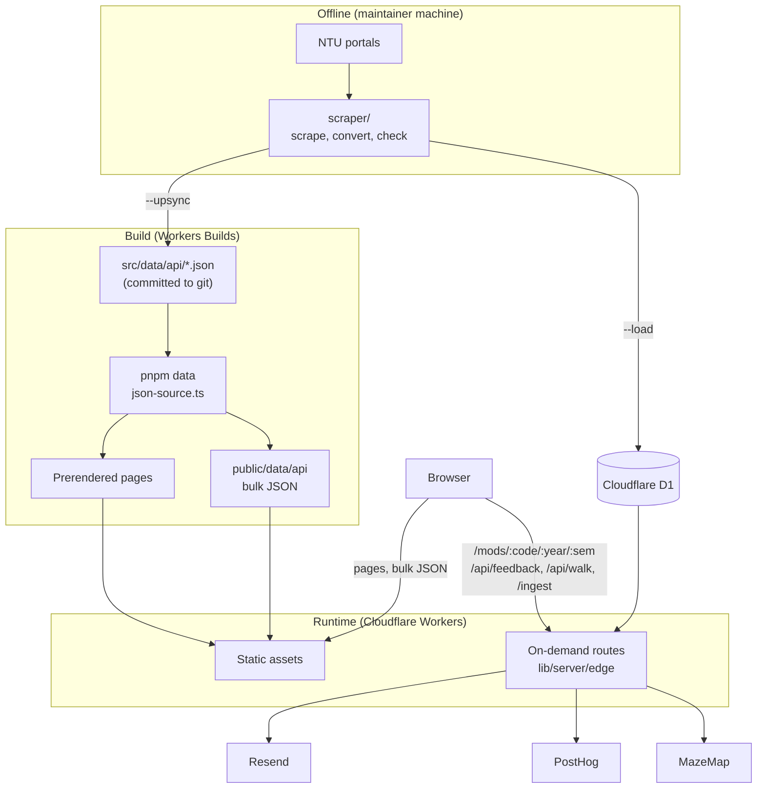

# Architecture

Part of [NTU Mods](../README.md). This page is the big picture; each part links to its detailed doc.

NTU Mods is a mostly static Astro site on Cloudflare Workers. Course data is scraped offline, committed as JSON, and baked into prerendered pages at build time. A small number of routes run on demand and read Cloudflare D1.

## Key decisions

- **Data is the source of truth in git.** `src/data/api` is committed, so every deploy is reproducible and reviewable. D1 is a second copy for the one route that cannot be prerendered.
- **Prerender everything it can.** Workers has no filesystem, so the build runs in plain Node and reads the JSON there. Only `/mods/:code/:year/:semester` (about 28k combinations), `/api/feedback`, `/api/walk` and `/ingest/*` run on demand.
- **Two read paths, kept apart.** Build-time code uses `lib/server/db/json-source.ts`; on-demand code uses `lib/server/edge/*` and the `DB` binding. On-demand code must never import the build-time path. See [src/README.md](../src/README.md#rendering-model).
- **The client is mostly local.** The timetable builder fetches the bulk JSON once and works in the browser, with Zustand holding state. Sharing encodes the timetable in the URL.
- **Analytics are proxied.** Events go to PostHog through a same-origin `/ingest` proxy; see [src/README.md](../src/README.md#analytics).

## Where to read next

| Topic                                    | Doc                                       |
| ---------------------------------------- | ----------------------------------------- |
| Code layout, rendering model, analytics  | [src/README.md](../src/README.md)         |
| Data flow, D1, `db:*` scripts            | [db/README.md](../db/README.md)           |
| Scraper pipeline, publishing, invariants | [scraper/README.md](../scraper/README.md) |
| Build, previews, secrets                 | [deployment.md](deployment.md)            |
| Per-semester tasks                       | [maintenance.md](maintenance.md)          |
