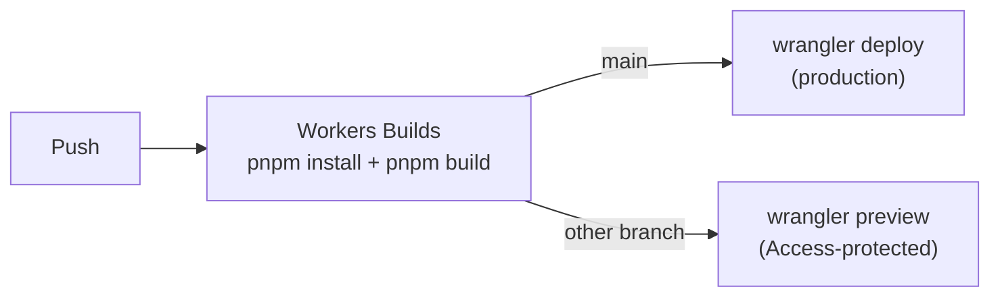

# Deployment

Part of [NTUMods](../README.md). System overview: [architecture.md](architecture.md). The routes that need D1 at runtime are described in [src/README.md](../src/README.md#rendering-model); seeding and verifying data is in [db/README.md](../db/README.md).

The site runs on Cloudflare Workers. The root [`wrangler.jsonc`](../wrangler.jsonc) is deliberately assets-only: `@astrojs/cloudflare` emits the real, self-contained worker config after a successful build, so deploy with that one.

```bash
npx wrangler deploy --config dist/server/wrangler.json
```



## Build settings

Production and previews use the Workers Builds install (a full `pnpm install --frozen-lockfile`, so its dependency cache applies) and the plain `pnpm build`. Nothing is customised: no `--prod`, no `NODE_ENV`, no `SKIP_DEPENDENCY_INSTALL`. The build does not need devDependencies, but Workers Builds installs before it runs the build command, so skipping them would only add a second install. Everything the build runs (`astro`, `tailwindcss`, `tsx`, `wrangler`, `@posthog/cli`) is in `dependencies`; leave it there.

These settings live in the dashboard (Workers & Pages, then `ntu-mods`, Settings, Builds), not in the repository:

| Setting         | Production                                               | Previews                                                  |
| --------------- | -------------------------------------------------------- | --------------------------------------------------------- |
| Build command   | `pnpm build`                                             | `pnpm build`                                              |
| Deploy command  | `npx wrangler deploy --config dist/server/wrangler.json` | n/a                                                       |
| Preview command | n/a                                                      | `npx wrangler preview --config dist/server/wrangler.json` |

Build variables on both: `CLOUDFLARE_ACCOUNT_ID` and `PUBLIC_POSTHOG_TOKEN`. Production also sets `POSTHOG_CLI_API_KEY` (a personal API key with the error tracking write and organization read scopes) and `POSTHOG_CLI_PROJECT_ID`, so error stack traces in PostHog point at real source lines ([`scripts/upload-sourcemaps.mjs`](../scripts/upload-sourcemaps.mjs)).

Measured on Workers Builds (October 2026): about 1m 40s to 3m 10s per build. The install phase takes 1 to 1m 40s depending on whether the dependency cache restores, the build itself 17 to 40s, and the deploy 9 to 47s.

## Preview deployments

Pushes to non-production branches get a preview through Cloudflare [Worker Previews](https://developers.cloudflare.com/workers/previews/) and Workers Builds ([build branches](https://developers.cloudflare.com/workers/ci-cd/builds/build-branches/#configure-preview-builds)). Set it up in the dashboard under Settings, Builds:

1. **Branch control:** set the production branch to `main` and tick **Enable Preview Builds**.
2. **Preview command:** use `npx wrangler preview --config dist/server/wrangler.json`, because this Worker deploys from the adapter-generated config. Any custom command must still invoke `npx wrangler preview`.
3. **Worker Previews switch:** if the Worker was connected before Worker Previews existed, complete the one-time **Set up Worker Previews** switch in the Builds settings banner. It is irreversible.
4. **Bindings and secrets:** previews do not inherit production settings. The `DB` D1 binding (the production database, which previews only read) is declared in the `previews` block of `wrangler.jsonc`, so nothing is needed in the dashboard for it. Secrets are not in config. To get the feedback form and PostHog on previews, add `RESEND_KEY` and `PUBLIC_POSTHOG_TOKEN` through the preview settings or `npx wrangler preview base-config secret put <NAME>`.
5. **Access control:** previews are served on `*.ntumods.com`, which, unlike `workers.dev` previews, gets no automatic `X-Robots-Tag: noindex`. Protect them with Cloudflare Access instead: Settings, Domains & Routes, then **Enable Cloudflare Access** on Preview URLs (previews only, not production).

Preview builds skip the IndexNow submission (`WORKERS_CI_BRANCH` is not `main`).

## Secrets

Set these as Worker secrets (not in `.env`); they are read through `locals.runtime.env`.

| Name                   | Used by                                         |
| ---------------------- | ----------------------------------------------- |
| `RESEND_KEY`           | `/api/feedback`, which sends the feedback email |
| `PUBLIC_POSTHOG_TOKEN` | PostHog, client and server-side capture         |

## MCP server

`/mcp` is public and needs no secret to run. It adds one rate limit binding, `MCP_LIMITER` (3000 a minute per IP, a flood ceiling rather than a per-user limit), declared in `wrangler.jsonc`. Previews do not inherit it, so previews are not limited. Design and limits: [mcp.md](mcp.md).

**Kill switch.** Set the optional `MCP_DISABLED` secret to any value and `/mcp` answers 503 on the next request. It is a secret, so deploys keep it, and it works on the free plan with no build.

```bash
npx wrangler secret put MCP_DISABLED --name ntu-mods
```

Enter `1` when asked. Or use the dashboard: Workers & Pages, `ntu-mods`, Settings, Variables and Secrets, add a secret named `MCP_DISABLED`. To turn the server back on, remove it:

```bash
npx wrangler secret delete MCP_DISABLED --name ntu-mods
```

**Billing alerts.** Set up Cloudflare notifications for Workers usage and a usage-based billing threshold in the dashboard. A flood costs requests and log events rather than D1 work, and there is no spend cap.

A WAF rate rule is optional and no better than `MCP_LIMITER`: it counts per IP per data center, so it is the same kind of limit, applied before the worker runs.
