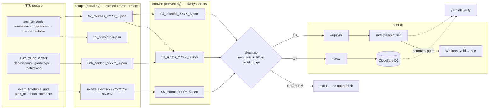

# NTU Course Scraper

Scrapes the [NTU class schedule portal](https://wish.wis.ntu.edu.sg/webexe/owa/aus_schedule.main),
the course-content portal and the exam-timetable portal, and turns them into the
three JSON files per semester that the site consumes.

```
portal.py    HTTP + HTML parsing for the three NTU portals (session reuse, retries, timeouts)
convert.py   pure transforms: raw scrape -> mdata / indexes / exams
check.py     invariants + diff against src/data/api; exit 1 = do not publish
main.py      the pipeline: scrape -> convert -> check -> --load / --upsync
```



Only the exam CSVs are committed (`data/.gitignore` drops the JSON).

## Setup

Python 3.12. Deps: `pip install -r requirements.txt` (`requests`, `beautifulsoup4`;
`anthropic` + `python-dotenv` only for `compare_agent.py`).

## Usage

> Always quote semester codes: `"2025;2"` not `2025;2` — `;` is a shell separator.

```bash
python3 main.py                                    # latest semester; reuses cached scrape if present
python3 main.py -s "2026;1" --refetch              # fresh scrape of one semester
python3 main.py -s "2026;1" --refetch --load --upsync   # ...and publish to both destinations
python3 main.py -s "2026;1" --scope exams --refetch --load --upsync   # refresh only the exam timetable
python3 main.py -s all --from "2025;1" --load      # rebuild every semester from 2025;1 on
python3 main.py -s "2026;1" --load --dry-run       # see what a load would do without touching D1
python3 check.py "2026;1"                          # re-run just the publish gate
```

| Flag              | Meaning                                                                                 |
| ----------------- | --------------------------------------------------------------------------------------- |
| `-s, --semester`  | `latest` (default), a code like `"2026;1"`, or `all`                                    |
| `-w, --workers`   | Parallel requests (default 4). Be kind to NTU's servers.                                |
| `--refetch`       | Ignore cached `02_courses` / exam CSV and hit the portal again. Conversion always reruns. |
| `--scope`         | `courses` (02–04 only) or `exams` (05 only). Applies to scraping, checking and loading. |
| `--plan-no`       | Override the exam portal's `p_plan_no`. Normally auto-detected from the portal.        |
| `--from`          | With `all`: this semester and newer.                                                    |
| `--load`          | Publish to D1 via `scripts/db/load-semester.mjs` after the check passes.               |
| `--upsync`        | Copy `03/04/05` into `src/data/api/{metadata,indexes,exams}` after the check passes.   |
| `--dry-run`       | With `--load`/`--upsync`: print, change nothing.                                       |
| `--force`         | Publish even if the check fails or D1 row counts drop sharply. Only when the drop is real. |

### What the check gates

`check.py` runs before any publish and refuses (exit 1) when:

- the new course/index/exam total is below 80% of what's live in `src/data/api` (portal error page, partial scrape)
- more than 5% of surviving courses lost `description` or `gradeType` (content-portal scrape failed)
- structural invariants below are violated

Everything else (courses added/removed, orphaned exams, `day=0` slots, a few lost prerequisites) is printed as a note.

### Exams

The exam timetable comes from `exam_timetable_und.Get_detail`, which needs a per-semester
`p_plan_no`. `portal.fetch_exam_plans()` reads the released plans off the portal's
option page (labels like `AY2026-27 SEM 1`) so this is automatic; `--plan-no` is
an escape hatch. If the timetable isn't released yet the existing CSV is kept, or an
empty `05_exams` is written when there is none. Special terms (`S`/`T`) have no UE
timetable. NTU keeps revising the timetable through the semester — re-run with
`--scope exams --refetch` rather than trusting a CSV fetched once.

## Publishing

Two independent destinations; both are needed:

| Flag       | Publishes to                                                                 |
| ---------- | ---------------------------------------------------------------------------- |
| `--load`   | Cloudflare D1 — the on-demand historic-snapshot route reads this live        |
| `--upsync` | `src/data/api` — prerendered pages and the client's bulk JSON build from this. **Commit and push**; that push is what makes the site show new data. |

A load is a `DELETE` of that scope's rows followed by `INSERT`s, applied as one
file through `wrangler d1 execute` (atomic). Replace rather than merge, because
merging cannot express a cancelled index. The loader stages into `db/ntu-mods.sqlite`,
which must be a replica of the database being loaded — `yarn db:pull` pulls
`ntu-mods-dev` by default while the loader writes `ntu-mods`, so pull the one you
intend to load (`NTU_MODS_D1=ntu-mods yarn db:pull`). It refuses a >20% row drop
without `--force`.

`src/data/api/semesters.json` is generated at build time from the metadata files;
a new semester appears once its metadata lands. Afterwards, from the repo root:

```bash
yarn db:verify   # D1 matches src/data/api exactly
```

## Walking routes (D1 `walks` table)

`/api/walk` routes through MazeMap once per pair, then keeps the answer in the
`walks` D1 table (and the edge cache), so a pair is never routed twice. Seed
the busiest pairs up front so their first request is already a hit:

```bash
yarn db:seed-walks --limit 3000      # polite, resumable; writes db/out/walks.sql
npx wrangler d1 execute DB --remote --file db/out/walks.sql
```

Pairs are venues with back-to-back classes (next starts within an hour of the
last ending), ranked by class count. `--sem` picks the semester (default the
newest), `--workers` is how many calls run at once.

**When the venue data changes** (`scraper/venues.py` rebuilt), purge and reseed:
bump `ROUTE_CACHE_VERSION` in `src/lib/walk-route.ts`, run
`npx wrangler d1 execute DB --remote --command "DELETE FROM walks"`, then seed
again. Old rows are ignored by version even before the delete.

## Semester codes

`YYYY;S` where `YYYY` is the **academic** year: `2025;1` = Aug–Nov 2025, `2025;2` = Jan–Apr 2026,
`2025;S` / `2025;T` = special terms in mid-2026. Exam CSVs are named by calendar span:
`exams-2025-2026-s2.csv`.

## Data invariants

What `check.py` enforces (hard) and notes (soft) on a `03/04/05` triplet:

**`03_mdata`** — every entry has `code`, `title`, `au`, `searchKeys`; `au` parses as a
non-negative float (`0.0` exists, e.g. HW0001); `prerequisite` is absent or
`list[list[str]]` (outer = OR, inner = AND); no field is the empty string.

**`04_indexes`** — `{ code: { index: [slot] } }`; each slot has exactly
`key, type, group, day, time, venue, remarks, duration` with `key` = index; `day` in 1–7,
or 0 for no scheduled day (distance learning — valid, noted); `time` is `HHMM-HHMM` with
start < end; `duration = ceil(minutes / 30)`; every course exists in mdata. `type` outside
`LEC LAB SEM TUT DES PRJ` is noted, not rejected. Identical slots under one index are
deduplicated by the converter; slots differing only in remarks/venue legitimately repeat.

**`05_exams`** — `day` in 1–7; `start_time`/`end_time` like `9.00 am`. Exams for courses
absent from mdata (about a dozen a semester) are noted.

## Gotchas

- Quote semester codes.
- The portal's semester list is not chronologically ordered; `main.py` sorts by code, never by list position.
- Special terms have far fewer courses — low counts there are normal.
- A course under several programmes appears once in mdata with all programmes in `searchKeys`.
- `--load` never touches `src/data/api`; `--upsync` never touches D1.

## Optional: validation agent

`compare_agent.py` cross-checks scraped output against the live portal using Claude.
Needs `ANTHROPIC_API_KEY` in `.env`. Not part of the pipeline.
